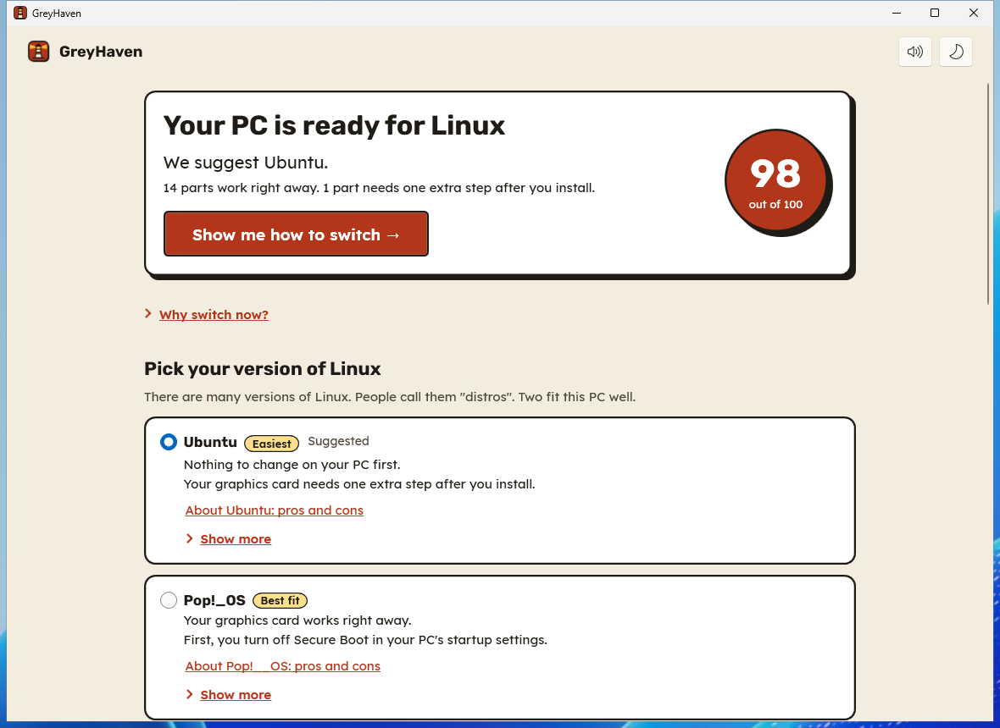
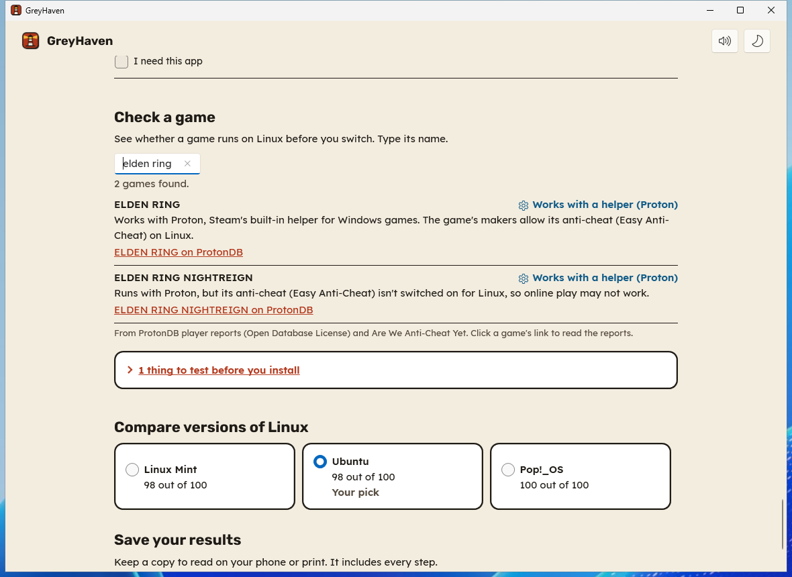
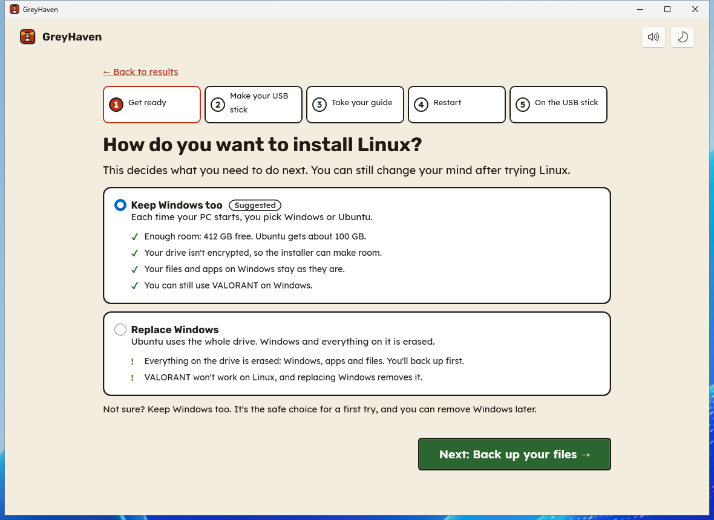
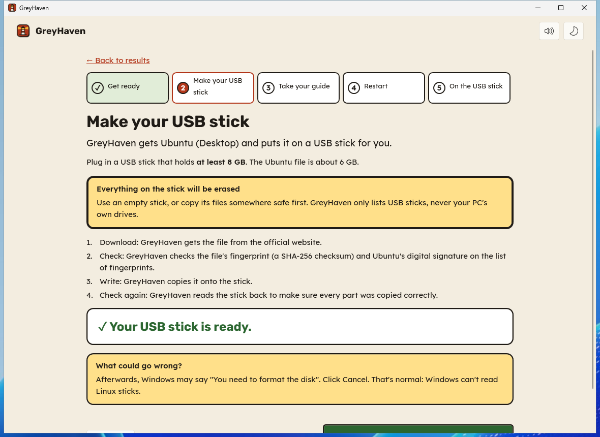
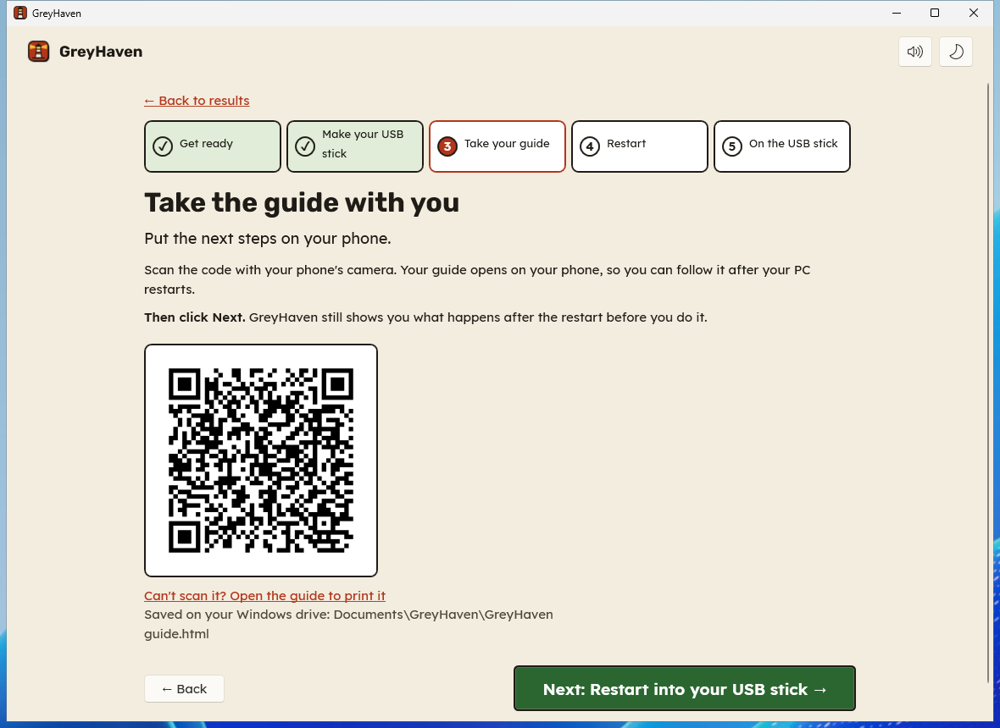

  <picture>
    <source media="(prefers-color-scheme: dark)" srcset="assets/brand/banner-dark.png">
    
  </picture>

  <a href="https://github.com/VernsMagerns/greyhaven/releases/latest/download/GreyHaven-Setup.exe"><b>Download for Windows</b></a>
  &nbsp;·&nbsp; <a href="https://greyhaven.pages.dev">Website</a>
  &nbsp;·&nbsp; <a href="#how-it-works">How it works</a>
  &nbsp;·&nbsp; <a href="#is-it-safe">Is it safe?</a>
  &nbsp;·&nbsp; <a href="#questions">Questions</a>

  
  
  

**GreyHaven is a free Windows app for people who are curious about Linux but don't know where
to start.** It checks the parts inside your PC and tells you which version of Linux fits best.
Then it walks you through switching, one step at a time: it helps you back up your files, makes
the USB stick and puts the next steps on your phone. It won't change anything without asking.

  

## How it works

| | |
|---|---|
| **1. Check** | Scan your PC in under a minute. Every part is checked against the Linux versions' own driver lists. You see what works right away, what needs one extra step, and which of your apps and games come with you. |
| **2. Choose** | Pick **Ubuntu**, **Linux Mint** or **Pop!_OS**, with plain pros and cons. **Keep Windows too** (you choose each time your PC starts) or replace it. |
| **3. Switch** | GreyHaven downloads Linux, checks it's the official file, and makes your USB stick. It puts your guide on your phone with a QR code, then restarts your PC into the stick. You try Linux first and install only when you're happy. |

<table>
  <tr>
    <td width="50%"> <b>Your apps and games.</b> See what works on Linux, what to use instead, and search any game.</td>
    <td width="50%"> <b>A guided walkthrough.</b> Each step is checked for your PC before you do it.</td>
  </tr>
  <tr>
    <td> <b>The USB stick, done for you.</b> Downloaded, checked, written and read back.</td>
    <td> <b>Your guide goes with you.</b> Scan the code and the next steps open on your phone.</td>
  </tr>
</table>

Screenshots show a sample PC. GreyHaven also has a dark mode and follows Windows' High Contrast colours.

## Get started

1. **[Download GreyHaven-Setup.exe](https://github.com/VernsMagerns/greyhaven/releases/latest/download/GreyHaven-Setup.exe)** and double-click it.
2. Open **GreyHaven** from the Start menu and click **Scan my PC**.
3. If you like what you see, click **Show me how to switch** and follow along.

**You'll need:** a Windows 10 or 11 PC (64-bit Intel or AMD; Windows on Arm isn't tested yet) and an internet connection. To switch, you'll
also need a USB stick of 8 GB or more that can be erased, and your phone. Allow an hour or two.

> **"Windows protected your PC"?** GreyHaven is new, and Windows warns about apps that not many
> people have downloaded yet. Click **More info**, then **Run anyway**. To check your download
> is the real one, compare it with the fingerprints in `SHA256SUMS.txt` on the
> [release page](https://github.com/VernsMagerns/greyhaven/releases/latest).

## Is it safe?

- **It asks before it changes anything.** Scanning needs no administrator rights and changes
  nothing. Before GreyHaven changes a Windows setting (like Fast Startup) or writes your USB stick,
  it says exactly what will happen. Then Windows asks your permission, for that one thing only.
- **It only erases what you choose.** Only USB drives are listed, never the drive Windows is on.
  You tick a box naming the stick before anything is erased. Big external drives need a second
  tick, so your backup is safe.
- **It checks every download.** Linux comes from the official source over a secure connection.
  GreyHaven checks the file's fingerprint and, for Ubuntu and Linux Mint, their digital signature.
  It reads the stick back afterwards to make sure it was written correctly.
- **You can go back.** You try Linux from the USB stick before installing anything. Not happy?
  Take the stick out, and Windows starts as before. With **Keep Windows too**, Windows and your
  files stay where they are.
- **Your details stay on your PC.** GreyHaven never reads your files. Your app list never leaves
  your PC. Online checks send part ID numbers only, and you can turn them off. See
  [PRIVACY.md](PRIVACY.md).
- **It doesn't guess.** Ratings come from official driver lists, community reports and named
  sources, shown next to each rating. When GreyHaven doesn't know, it says "Not sure".
- **It's open source.** Every line is here, under the MIT licence. Every release has published
  fingerprints and is built by this repository's public workflow.

## Questions

<b>Will I lose my files?</b>

Not if you choose **Keep Windows too**: Windows, your apps and your files stay as they are, and
Linux gets space next to them. GreyHaven still asks you to back up first, because changing the
drive's layout is the one step that can go wrong. **Replace Windows** erases the drive, and
GreyHaven won't let you go on until your backup checklist is done.

<b>Which versions of Linux does it support?</b>

Ubuntu 26.04 LTS, Linux Mint 22.3 and Pop!_OS 24.04: three of the most popular, all free and
well supported. GreyHaven suggests the one that fits your PC and explains why, with pros and cons
for each. There are many more versions of Linux; once you're comfortable, you can try any of them
the same way.

<b>What about my games?</b>

GreyHaven lists the games and apps on your PC and says which work on Linux, using ProtonDB player
reports and the Are We Anti-Cheat Yet list. Games whose anti-cheat blocks Linux are flagged
clearly. **Check a game** searches any game, installed or not.

<b>What if something doesn't work on Linux?</b>

That's what trying it from the USB stick is for. GreyHaven's guide has a short checklist (screen,
network, sound, sleep) to try before you install. If something important doesn't work, take the
stick out and Windows starts as before.

<b>Does it send anything about me?</b>

Only if you leave the online checks on. The ID numbers of parts GreyHaven doesn't recognise go to
linux-hardware.org. GreyHaven also asks GitHub whether there's a newer version. No names, no files,
no app list. [PRIVACY.md](PRIVACY.md) lists exactly what's sent and when.

<b>Is it really free?</b>

Yes. No ads, no account, no paid version.

<b>I'm an IT admin.</b>

Each release also has `GreyHaven.msi` for silent installs (`msiexec /i GreyHaven.msi /qn`) and a
portable zip that runs without installing.

## Help make it better

- **Found a problem, or a part GreyHaven got wrong?**
  [Open an issue](https://github.com/VernsMagerns/greyhaven/issues). Ratings live in plain data
  files that anyone can improve without writing code; see [CONTRIBUTING.md](CONTRIBUTING.md).
- **Security problem?** Please report it privately: [SECURITY.md](SECURITY.md).
- **Building from source:** [docs/developing.md](docs/developing.md).

## Thanks

GreyHaven stands on open data: the [Linux Hardware Database](https://linux-hardware.org),
[ProtonDB](https://www.protondb.com) report dumps (ODbL), [Are We Anti-Cheat Yet](https://areweanticheatyet.com) (MIT),
and the Ubuntu, Linux Mint and Pop!_OS projects' own package lists. Fonts: Rubik and Lexend
(SIL Open Font License).

## Licence

Code: [MIT](LICENSE). Compatibility data in `data/`: CC-BY-4.0 ([data/LICENSE](data/LICENSE)).
Linux, Ubuntu, Linux Mint and Pop!_OS are trademarks of their owners; GreyHaven isn't
affiliated with them. [Code of conduct](CODE_OF_CONDUCT.md).
