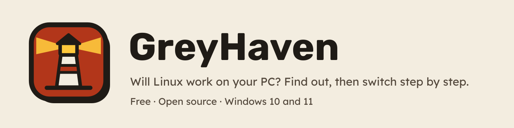
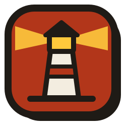

# GreyHaven brand

GreyHaven helps people who have only ever used Windows switch to Linux safely. The brand has one
job: **make a nervous first-timer feel they're in good hands.** Warm and friendly, never slick;
honest about limits; every promise backed by something they can check.

All brand images are drawn by [tools/brand/build.py](../tools/brand/build.py). Change them
there and rerun it, rather than editing the files.

## The mark

A **lighthouse** on a tomato sticker tile: a haven that lights the way in. GreyHaven checks the
route first (the scan), then lights each step (the walkthrough and guide).

| File | Use |
|---|---|
| `assets/brand/mark.svg` | The mark with its sticker shadow. Anywhere 48 px or larger. |
| `assets/brand/mark-flat.svg` | No shadow, the tile fills the square. Favicons and tight spaces. |
| `assets/brand/icon-16.png` … `icon-256.png` | Ready-made sizes. 32 px and smaller use a larger lighthouse without light beams, so it stays readable. |
| `assets/brand/greyhaven.ico` | The Windows app, the helper and the installer. |
| `assets/brand/banner-light.png`, `banner-dark.png` | The README header. |
| `assets/brand/social-preview.png` | GitHub's social preview (1280 × 640). |

**Rules:**
- Leave clear space around the mark of at least a quarter of its width.
- Don't recolour, rotate, stretch, outline or add effects. On dark backgrounds use it as it is:
  the tomato tile carries it.
- Don't put the mark inside another shape, or use the lighthouse without its tile.
- Smallest size: 16 px (use `icon-16.png`, not a scaled-down large one).

## Name

**GreyHaven**: one word, capital G and H. Not "Grey Haven", "Greyhaven" or "GH" in anything
people read.

## Colours

The app's own palette (source of truth: `src/GreyHaven.Presentation/Theming/Palette.cs`). Every
text colour passes WCAG AA on its background in both themes, and a test enforces it.

| Role | Light | Dark |
|---|---|---|
| Page (paper) | `#F3EDE0` | `#0D1218` |
| Card | `#FFFFFF` | `#18212B` |
| Ink (text, outlines, shadows) | `#1F1B16` | `#F3EFE7` text, `#8C9BAB` outlines |
| Secondary text | `#52473B` | `#B8C3CE` |
| Tomato (the accent: main buttons, links, the mark) | `#B2361A` | `#FF9065` |
| Go (Next buttons, "works") | `#2B6630` | `#8FD69B` |
| Butter (highlights, the lighthouse lamp, cautions) | `#FFC93C` / notices `#FFE08A` | `#FFCF5C` |
| Extra step | `#0D5986` | `#8DCBF5` |
| Won't work | `#9E1C20` | `#FF9F95` |

High Contrast mode always uses Windows' own colours. Ratings are never shown by colour alone:
there's always an icon and a word.

## Type

- **Rubik** (Bold) for headings and the wordmark.
- **Lexend** (Regular, SemiBold) for everything else. It was designed for easy reading.

Both are SIL Open Font License 1.1 and ship in `assets/fonts`.

## Shapes and pictures

"Market Day": cards look like stickers on paper, with thick ink outlines (2–4 px), rounded corners
and a hard offset shadow down and to the right. Pictures in the walkthrough are flat drawings in
the same style (`tools/illustrations`). Screenshots of real installers are used where showing
the real thing matters more.

## Voice

- **Plain words, short sentences**, at about a 6th-grade reading level. "Your PC", "USB stick",
  "Windows will ask for permission". Technical terms only behind "Show more", and explained.
- **Calm and specific.** Say what will happen, what won't, and what to do if something goes
  wrong. "Nothing on your PC changed."
- **Honest.** Never "100% compatible" or "guaranteed". Say where a rating comes from, and say
  "Not sure" when GreyHaven doesn't know.
- **No hype, no fear.** No exclamation marks outside the goodbye. No "AI", "revolutionary",
  "seamless" or "effortless". Never rush people or make them feel silly.
- **No eyebrow labels** (small all-caps text above headings). Lead with the heading.

## Screenshots

- Taken from the real app by the UI smoke test in CI (`tools/GreyHaven.UiSmoke`), on a sample PC,
  never a real person's PC. Captions say so.
- Light mode for the README's main images, with one dark-mode shot to show it exists.
